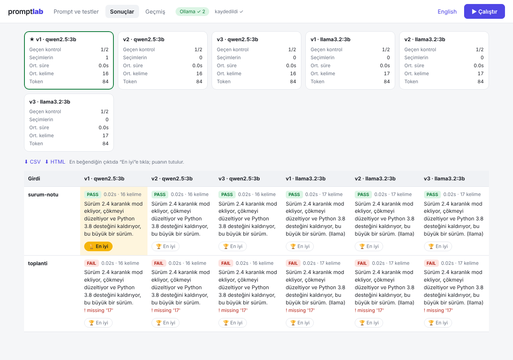

# promptlab

Find out which prompt (and which model) works best, with your own test cases instead of guesswork.

You write a few versions of a prompt, add some sample inputs, press **Run**, and promptlab shows every output side by side, checks them automatically, and keeps score. It runs **free and offline** with local models through [Ollama](https://ollama.com), or with the Anthropic API if you have a key.



## Features

- **Web UI** that runs on your own computer (`promptlab`): edit prompts, test cases and settings, watch results stream in
- **Compare prompts and models** in one run: pick several Ollama models and every prompt runs on each of them
- **Auto-checks** with a pass/fail summary: max/min words, must contain, must not contain, starts with, regex, valid JSON
- **Your verdict**: click 🏆 *Best* on the output you like most; wins are tallied per version
- **Repeat runs** to see how stable each prompt is, optional **model rating** (1-5 against criteria you write)
- **History**: every run is saved; export to **CSV** (opens in Excel) or a shareable **HTML** report
- **Recommended version**: the best version is starred automatically (your picks, check pass rate, model rating, speed), plus a **stability %** when you repeat runs
- **More checks**: `any_of`, `equals`, `json_keys`, `max_sentences`, `min_chars`
- **Also a CLI** for scripts and quick runs: `compare` two runs, `import` test cases from CSV, `--fail-under 0.8` to fail a CI job
- **No dependencies** for local mode: pure Python standard library (3.9+)

## Install

```bash
git clone https://github.com/0mhmmdyldz0/promptlab.git
cd promptlab
pip install -e .
```

**Local and free:** install [Ollama](https://ollama.com/download), then `ollama pull qwen2.5:3b`.
**Anthropic API:** `pip install -e ".[anthropic]"` and set `ANTHROPIC_API_KEY`.

Check your setup any time with `promptlab doctor`.

## Use it

```bash
promptlab
```

This opens the UI in your browser. Click *Load example* the first time, edit the prompts and test cases, and press **Run** (Ctrl+Enter).

Your project is just files in the folder where you started it: `prompts/*.txt` and `inputs.json`, so you can edit them in any editor and commit them to git. Runs are saved in `.promptlab/runs/`.

Windows: double-click `baslat.bat`. macOS/Linux: `./start.sh`. Both keep your project in their own folder.

### Command line

```bash
promptlab init                      # example files (add --tr for Turkish)
promptlab run                       # every prompt in prompts/ against inputs.json
promptlab run --models qwen2.5:3b,llama3.2:3b --repeat 3 --csv out.csv
promptlab show                      # latest run, side by side
promptlab list                      # saved runs
promptlab export --html report.html
```

More commands:

```bash
promptlab compare <old-run-id>        # old run vs latest: what got fixed, what regressed
promptlab import cases.csv            # columns: name;checks;<variables>, checks like max_words=20|contains=2.4,dark mode
promptlab run --fail-under 0.8        # non-zero exit if any version passes <80% of checks
promptlab run --judge "friendly and accurate" --judge-model qwen2.5:7b
```

Useful `run` flags: `--models`, `--repeat N`, `--temperature`, `--system`, `--judge "criteria"`, `--html`, `--csv`, `--dry-run` (test your files without calling a model), `--provider auto|ollama|anthropic`.

## File formats

**Prompt** (`prompts/v1.txt`): plain text with `{{variable}}` placeholders.

**Test cases** (`inputs.json`):

```json
[
  {
    "name": "release-note",
    "vars": { "text": "Version 2.4 adds dark mode and fixes a crash." },
    "checks": { "max_words": 20, "contains": ["2.4"] }
  }
]
```

| Check | Meaning |
|-------|---------|
| `max_words`, `min_words`, `max_chars` | length limits |
| `contains`, `not_contains` | text (or list of texts), case-insensitive |
| `starts_with` | output must start with this text |
| `regex` | pattern (or list) that must match |
| `is_json` | output must be valid JSON (code fences are ignored) |

## Notes

- The server listens on `127.0.0.1` only and rejects requests from other websites.
- Small local models make rough judges; treat the model rating as a hint and trust your own 🏆 picks and the auto-checks more.
- Remote Ollama: set `OLLAMA_HOST`, e.g. `OLLAMA_HOST=192.168.1.20:11434`. Default model: `PROMPTLAB_MODEL`.
- Development: `python -m unittest discover -s tests`

## Ideas for contributions

- OpenAI-compatible providers
- Side-by-side diff highlighting between versions

## License

MIT. *Türkçe kurulum ve kullanım: [README.tr.md](README.tr.md).*
