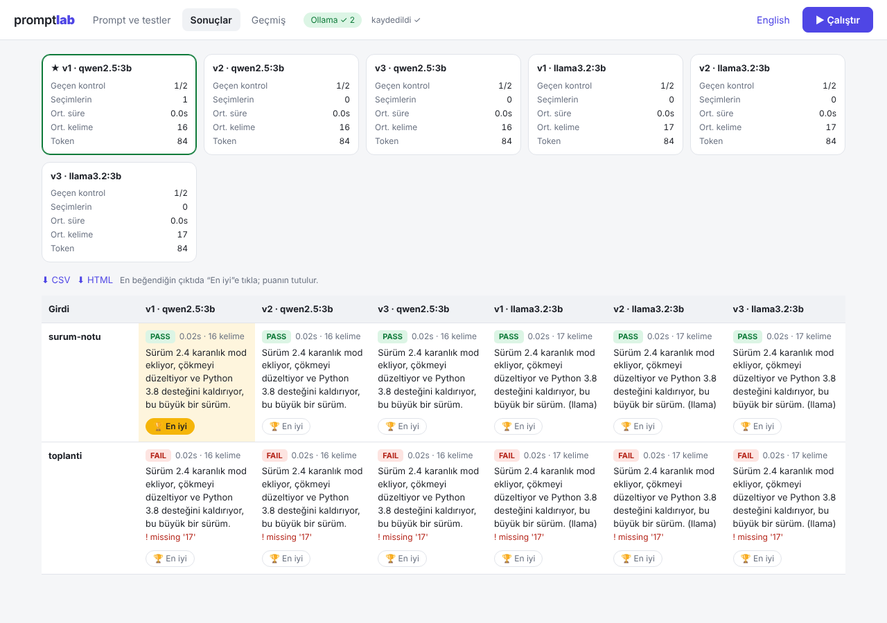

# promptlab

Hangi prompt'un (ve hangi modelin) daha iyi çalıştığını tahminle değil, kendi test örneklerinle bul.

Bir prompt'un birkaç sürümünü yazarsın, örnek girdiler eklersin ve **Çalıştır**'a basarsın. promptlab çıktıların hepsini yan yana gösterir, otomatik kontrol eder ve puan tutar. **Ücretsiz ve internetsiz** çalışır (Ollama ile bilgisayarındaki modeller). API anahtarın varsa Anthropic ile de çalışır.



## Neler yapabilir?

- **Web arayüzü** (bilgisayarında açılır): prompt'ları, testleri ve ayarları düzenle, sonuçları canlı izle
- **Prompt ve model karşılaştırma:** birkaç Ollama modeli seç, her prompt hepsinde çalışır
- **Otomatik kontroller:** en fazla/en az kelime, şunu içermeli, şunu içermemeli, şununla başlamalı, regex, geçerli JSON
- **Senin kararın:** en beğendiğin çıktıda 🏆 *En iyi*'ye tıkla, kazanma sayıları tutulur
- **Tekrarlı çalıştırma:** aynı prompt'un ne kadar tutarlı olduğunu gör; isteğe bağlı model puanı (1-5)
- **Geçmiş:** her çalıştırma kaydedilir; **CSV** (Excel'de açılır) veya **HTML** olarak dışa aktar
- **Otomatik "önerilen sürüm":** puanlar, geçen kontroller ve hıza göre ★ ile en iyi sürüm işaretlenir
- **Tutarlılık yüzdesi:** "Her birini tekrarla" açıkken aynı prompt'un her seferinde benzer cevap verip vermediğini gösterir
- **Yeni kontroller:** biri olmalı (`any_of`), tam eşitlik (`equals`), JSON anahtarları (`json_keys`), en fazla cümle, en az karakter
- **Excel'den test yükleme**, iki çalıştırmayı karşılaştırma (`compare`), CI için `--fail-under`
- Komut satırı da var

## Kurulum (Windows)

1. **Python:** python.org'dan kur ("Add python.exe to PATH" kutusunu işaretle).
2. **Ollama:** ollama.com/download'dan kur ve çalıştır.
3. **Model indir:** PowerShell'de `ollama pull qwen2.5:3b` (yaklaşık 2 GB; 4 GB ekran kartına rahat sığar). Daha iyi kalite için `ollama pull qwen2.5:7b` dene, daha yavaştır.
4. **Projeyi indir ve kur:**
   ```powershell
   git clone https://github.com/0mhmmdyldz0/promptlab.git
   cd promptlab
   pip install -e .
   ```
   (Git yoksa GitHub sayfasında **Code → Download ZIP** ile indirip klasöre çıkarabilirsin.)

Kontrol için: `promptlab doctor`

## Kullanım

En kolayı: **`baslat.bat`** dosyasına çift tıkla. Tarayıcıda arayüz açılır. Projen `projem` klasöründe tutulur.

Ya da terminalde:

```powershell
promptlab
```

(`promptlab` komutu bulunamazsa `python -m promptlab` yaz.)

İlk açılışta **Türkçe örnek yükle**'ye tıkla. Sonra:

1. **Prompt'lar:** metni düzenle, **Kopyala** ile yeni bir sürüm çıkar. Prompt'ta `{{text}}` gibi yer tutucular kullan.
2. **Test durumları:** her yer tutucu için bir alan çıkar. Altındaki **Otomatik kontroller**'e kurallarını yaz (ör. en fazla 20 kelime, "2.4" içermeli).
3. **Çalıştırma ayarları:** karşılaştırmak istediğin modelleri seç. İstersen "Her birini tekrarla" ile aynı testi birkaç kez çalıştır.
4. **Çalıştır** (veya Ctrl+Enter). Sonuçlar canlı gelir. Beğendiğin çıktıda **En iyi**'ye tıkla.
5. **Geçmiş** sekmesinden eski sonuçları aç, CSV'ye aktar.

Arayüz tarayıcının diline göre Türkçe/İngilizce açılır; sağ üstten değiştirebilirsin.

## Komut satırı

```powershell
promptlab init --tr
promptlab run
promptlab run --models qwen2.5:3b,llama3.2:3b --repeat 3 --csv sonuc.csv
promptlab show
promptlab list
promptlab export --html rapor.html
```

`--dry-run` ile model çağırmadan dosyalarını test edebilirsin.

### Yeni komutlar

```powershell
promptlab list                         # kayıtlı çalıştırmaları listeler
promptlab compare 20261111-101500      # o çalıştırma ile en sonuncuyu karşılaştırır (düzeldi mi, bozuldu mu?)
promptlab import testler.csv           # Excel'den inputs.json üret
promptlab run --fail-under 0.8         # herhangi bir sürüm kontrollerin %80'inden azını geçerse hata koduyla biter
promptlab run --judge "samimi ve doğru" --judge-model qwen2.5:7b   # puanlamayı daha güçlü bir modele yaptır
```

**CSV biçimi** (Excel'den "CSV UTF-8" olarak kaydet; `;` veya `,` olabilir): `name;checks;text` başlıklı bir tablo. `checks` sütununa kuralları `|` ile ayırarak yaz:
`max_words=20|contains=2.4,karanlık mod`. Prompt'taki her `{{degisken}}` için bir sütun ekle.

## Sorun giderme

| Sorun | Çözüm |
|-------|-------|
| Arayüzde "Ollama ✗" | Ollama uygulamasını başlat (sistem tepsisinde görünmeli) |
| "Model ... is not installed" | `ollama pull <model adı>` |
| İlk çalıştırma çok yavaş | Model ilk seferde belleğe yüklenir; sonrakiler hızlıdır |
| Sonuçlar kötü | Daha büyük model dene (`qwen2.5:7b`) ve `Sıcaklık` değerini 0.2 yap |
| Port dolu | Araç otomatik olarak sonraki portu dener; terminalde yazan adresi aç |

## Anthropic API ile (isteğe bağlı)

```powershell
pip install -e ".[anthropic]"
$env:ANTHROPIC_API_KEY="anahtarin"
```

Anahtar tanımlıysa araç otomatik Anthropic'i kullanır. Yerel modele dönmek için arayüzde sağlayıcıyı *ollama* seç.
